# Art Lab army sweep v3: all kingdoms

2026-09-27 10:39:03 · lab v2.0 · 96 assets · windowed · batch (one Godot process, stage built once), per-asset runs `quick=1` (no references / frame cost: R2 and B13 are judged by the army pass below / the Perf Lab). Re-run: `.\tools\art_lab\run_art_lab.ps1 -Sweep all`.

Time: batch **2699 s** (28.1 s / asset; first 22.0 s), silhouettes 68 s for 65 models, total **68 s** (1.1 min). Per-asset scorecards: `docs/art/lab/_army/assets/<name>/` (shots stay local: `.gitignore`). Ranked to-do list: `docs/art/lab/backlog.md` (written by `-Sweep all`).

**reuse=1**: the asset rows are the last sweep's scorecards (batch time = the sum of their lab times, not wall time); the silhouette pass below is fresh (2026-09-27 10:37:55).

Last full sweep: batch **2776 s** (28.9 s / asset; first 22.8 s), silhouettes 53 s for 65 models, total **2829 s** (47.2 min). Per-asset scorecards: `docs/art/lab/_army/assets/<name>/` (shots stay local: `.gitignore`). Ranked to-do list: `docs/art/lab/backlog.md` (written by `-Sweep all`).

## Per kingdom

| group | assets | FAIL | WARN | PASS | mean quality | worst | lab time |
|---|---|---|---|---|---|---|---|
| fire | 15 | 7 | 8 | 0 | 89 | ember_crucible 73 | 515 s (8.6 min) |
| ice | 17 | 6 | 11 | 0 | 92 | ice_wall 86 | 506 s (8.4 min) |
| nature | 17 | 6 | 11 | 0 | 89 | nature_keep 72 | 547 s (9.1 min) |
| shadow | 15 | 6 | 8 | 1 | 92 | shadow_hall 84 | 512 s (8.5 min) |
| neutral | 32 | 15 | 12 | 5 | 90 | essence_well 69 | 619 s (10.3 min) |

## Ranking (worst first)

Top improvement = the scorecard's "Improve next" #1; fix recipe = its `fixes.json` top item (task 1.A, when present); look-alike = the closest silhouette of the army pass (IoU over 4 turns / colour dE).

| # | asset | kingdom | kind / tier | result | quality | FAIL / WARN | top improvement | fix recipe | closest look-alike | scorecard |
|---|---|---|---|---|---|---|---|---|---|---|
| 1 | essence_well | neutral | building / hall | FAIL | 69 | WARN A1, FAIL R3, WARN R4, WARN R5c | **Contrast vs ground (meadow)**: R3 Contrast vs ground (meadow): Raise the contrast of the key read on meadow (dE 14.9): value is close to the ground (dL -5): lighten the... | (= top improvement) |  | [card](assets/essence_well/scorecard.md) |
| 2 | nature_keep | nature | building / keep | FAIL | 72 | FAIL B4, FAIL B8, WARN B9, FAIL R3, WARN R3t, WARN R6cb, WARN R5c, WARN R5 | **Contrast vs ground (meadow)**: shader_parameter/base_color of `Leaves` #59b340 -> #65ff85 (21% of the visible body): predicted dE R3 meadow 4.9 -> 18.3, R3t fire 49.2 -... | computed R3: shader_parameter/base_color of `Leaves` #59b340 -> #65ff85 (21% of the visible body): predicted dE R3 meadow 4.9 -> 18.3, R3... |  | [card](assets/nature_keep/scorecard.md) |
| 3 | ember_crucible | fire | building / hall | FAIL | 73 | FAIL B8, WARN A1, WARN R1, WARN R4k, WARN R4, WARN R5 | **Unique materials**: B8 12 -> 8 materials: use one material for look-alike pairs: `StandardMaterial3D#-17671` -> `StandardMaterial3D#-25632` (dE 0.0), `Standa... | computed B8: 12 -> 8 materials: use one material for look-alike pairs: `StandardMaterial3D#-17671` -> `StandardMaterial3D#-25632` (dE 0.0... |  | [card](assets/ember_crucible/scorecard.md) |
| 4 | magpie_den | neutral | building / hall | FAIL | 81 | FAIL B4, FAIL B8, WARN A1, WARN R5 | **Unique materials**: B8 19 -> 8 materials: use one material for look-alike pairs: `StandardMaterial3D#-21508` -> `StandardMaterial3D#-74709` (dE 0.0), `Standa... | computed B8: 19 -> 8 materials: use one material for look-alike pairs: `StandardMaterial3D#-21508` -> `StandardMaterial3D#-74709` (dE 0.0... |  | [card](assets/magpie_den/scorecard.md) |
| 5 | ruin_warden | neutral | unit / creature | FAIL | 83 | FAIL B2, WARN B4, WARN R8w, WARN R10, WARN R4, WARN R5, WARN R5w | **Draw instances at rest**: B2 12 -> 11 (want <= 10): `GapLight`, `Core` are keep_separate under `Chest`: keep only the animated / toggled one separate [fixes.json #1] | computed B2: 12 -> 11 (want <= 10): `GapLight`, `Core` are keep_separate under `Chest`: keep only the animated / toggled one separate | shadow_knight 0.64 / dE 57 | [card](assets/ruin_warden/scorecard.md) |
| 6 | nature_hall | nature | building / hall | FAIL | 83 | FAIL B4, FAIL B8, WARN B9, WARN R5c, WARN R5 | **Unique materials**: B8 21 -> 9 materials: use one material for look-alike pairs: `StandardMaterial3D#-10823` -> `StandardMaterial3D#-24714` (dE 0.0), `Standa... | computed B8: 21 -> 9 materials: use one material for look-alike pairs: `StandardMaterial3D#-10823` -> `StandardMaterial3D#-24714` (dE 0.0... |  | [card](assets/nature_hall/scorecard.md) |
| 7 | greywater_lodge | neutral | building / hall | FAIL | 83 | FAIL B4, FAIL B8, WARN B9, WARN A1 | **Vertices**: B4 24101 -> 12093 (want <= 12000): `Structure` 21865 -> 10933 verts; `HoundMesh` 861 -> 431 verts; `Rubble` 480 -> 240 verts; `Lantern` 3... | computed B4: 24101 -> 12093 (want <= 12000): `Structure` 21865 -> 10933 verts; `HoundMesh` 861 -> 431 verts; `Rubble` 480 -> 240 verts; `... |  | [card](assets/greywater_lodge/scorecard.md) |
| 8 | hollow_stag | neutral | unit / creature | FAIL | 84 | FAIL B2, WARN B4, WARN R8w, WARN R10, WARN R5 | **Draw instances at rest**: B2 13 -> 13 (want <= 10): no merge group found (every mesh has its own pivot and material): Fewer keep_separate parts, bake static props ... | computed R5: Glow points 4 -> 2 (want 1-3): hollow_stag_shade crack_strength 1.0 -> 0.19 (dim under the bloom level: 2 point(s), peak 3.9... | direwolf 0.57 / dE 28 | [card](assets/hollow_stag/scorecard.md) |
| 9 | shadow_hall | shadow | building / hall | FAIL | 84 | FAIL B5, FAIL B8, WARN B9, WARN R5 | **Unique materials**: B8 13 -> 8 materials: use one material for look-alike pairs: `StandardMaterial3D#-73222` -> `StandardMaterial3D#-59258` (dE 0.0), `Standa... | computed B8: 13 -> 8 materials: use one material for look-alike pairs: `StandardMaterial3D#-73222` -> `StandardMaterial3D#-59258` (dE 0.0... |  | [card](assets/shadow_hall/scorecard.md) |
| 10 | tavern_model | neutral | building / hall | FAIL | 84 | FAIL B8, WARN A1, WARN R5c, WARN R5 | **Unique materials**: B8 16 -> 8 materials: use one material for look-alike pairs: `StandardMaterial3D#-52373` -> `StandardMaterial3D#-60218` (dE 0.0), `Standa... | computed B8: 16 -> 8 materials: use one material for look-alike pairs: `StandardMaterial3D#-52373` -> `StandardMaterial3D#-60218` (dE 0.0... |  | [card](assets/tavern_model/scorecard.md) |
| 11 | wayshrine | neutral | building / hall | WARN | 85 | WARN A1, WARN R1, WARN R5 | **Silhouette area at 40 m**: R1 4749 -> ~5750 px: grow the 40 m read x1.1 (area goes with the square: scale the key masses / body 10 %) [fixes.json #1] | computed R1: 4749 -> ~5750 px: grow the 40 m read x1.1 (area goes with the square: scale the key masses / body 10 %) |  | [card](assets/wayshrine/scorecard.md) |
| 12 | fire_hall | fire | building / hall | FAIL | 85 | FAIL B5, FAIL B8, WARN B9, WARN R5 | **Unique materials**: B8 13 -> 8 materials: use one material for look-alike pairs: `StandardMaterial3D#-84631` -> `StandardMaterial3D#-70794` (dE 0.0), `Standa... | computed B8: 13 -> 8 materials: use one material for look-alike pairs: `StandardMaterial3D#-84631` -> `StandardMaterial3D#-70794` (dE 0.0... |  | [card](assets/fire_hall/scorecard.md) |
| 13 | wayfinder | neutral | unit / champion | FAIL | 85 | WARN B4, FAIL B8, WARN R8w, WARN R5, WARN R5w | **Unique materials**: B8 10 -> 5 materials: use one material for look-alike pairs: `StandardMaterial3D#-46754` -> `StandardMaterial3D#-27747` (dE 0.0), `Standa... | computed B8: 10 -> 5 materials: use one material for look-alike pairs: `StandardMaterial3D#-46754` -> `StandardMaterial3D#-27747` (dE 0.0... | tracker 0.66 / dE 22 | [card](assets/wayfinder/scorecard.md) |
| 14 | dragon_roost | fire | building / hall | FAIL | 86 | FAIL B8, WARN B9, WARN R4k, WARN R6cb, WARN R5 | **Unique materials**: B8 17 -> 8 materials: use one material for look-alike pairs: `StandardMaterial3D#-7256` -> `StandardMaterial3D#-70684` (dE 0.0), `Standar... | computed B8: 17 -> 8 materials: use one material for look-alike pairs: `StandardMaterial3D#-7256` -> `StandardMaterial3D#-70684` (dE 0.0)... |  | [card](assets/dragon_roost/scorecard.md) |
| 15 | trade_post | neutral | building / small | WARN | 86 | WARN B4, WARN B8, WARN B9, WARN A1 | **Vertices**: B4 10711 -> 5764 (want <= 6000): `Structure` 6310 -> 3155 verts; `Sign0` 1824 -> 912 verts; `Awning` 546 -> 273 verts; `Rubble` 480 -> 24... | computed B4: 10711 -> 5764 (want <= 6000): `Structure` 6310 -> 3155 verts; `Sign0` 1824 -> 912 verts; `Awning` 546 -> 273 verts; `Rubble`... |  | [card](assets/trade_post/scorecard.md) |
| 16 | nature_hollow | nature | building / hall | FAIL | 86 | FAIL B8, WARN B9, WARN R3, WARN R3t | **Unique materials**: B8 18 -> 9 materials: use one material for look-alike pairs: `StandardMaterial3D#-73353` -> `StandardMaterial3D#-16893` (dE 0.0), `Standa... | computed B8: 18 -> 9 materials: use one material for look-alike pairs: `StandardMaterial3D#-73353` -> `StandardMaterial3D#-16893` (dE 0.0... |  | [card](assets/nature_hollow/scorecard.md) |
| 17 | ice_wall | ice | building / small | WARN | 86 | WARN B8, WARN R1, WARN R5c, WARN R5 | **Silhouette area at 40 m**: R1 2759 -> ~5750 px: grow the 40 m read x1.44 (area goes with the square: scale the key masses / body 44 %) [fixes.json #1] | computed R1: 2759 -> ~5750 px: grow the 40 m read x1.44 (area goes with the square: scale the key masses / body 44 %) |  | [card](assets/ice_wall/scorecard.md) |
| 18 | market_nature | nature | building / hall | FAIL | 86 | FAIL B8, WARN B9, WARN R5c, WARN R5 | **Unique materials**: B8 19 -> 10 materials: use one material for look-alike pairs: `StandardMaterial3D#-60158` -> `StandardMaterial3D#-46252` (dE 0.0), `Stand... | computed B8: 19 -> 10 materials: use one material for look-alike pairs: `StandardMaterial3D#-60158` -> `StandardMaterial3D#-46252` (dE 0.... |  | [card](assets/market_nature/scorecard.md) |
| 19 | cinder_dragon | fire | titan / titan | WARN | 86 | WARN B9m, WARN R5c, WARN R5, WARN R5w | **Glow points at 40 m**: Glow points 9 -> 5 (want 1-5): cinder_membrane ember_energy 1.0 -> 0.2 (dim under the bloom level: 4 point(s), peak 3.67 x the level) [fi... | computed R5: Glow points 9 -> 5 (want 1-5): cinder_membrane ember_energy 1.0 -> 0.2 (dim under the bloom level: 4 point(s), peak 3.67 x t... | frost_dragon 0.82 / dE 65 | [card](assets/cinder_dragon/scorecard.md) |
| 20 | fire_tower | fire | building / small | FAIL | 86 | FAIL B5, WARN B8, WARN B9, WARN R6cb, WARN R5c | **Real lights**: B5 Real lights: No Light3D: emission >= 2.5 on the glow part and the bloom carries it (art-keep 0.4) [fixes.json #1] | computed B8: 11 -> 6 materials: use one material for look-alike pairs: `StandardMaterial3D#-73353` -> `StandardMaterial3D#-79643` (dE 0.0... |  | [card](assets/fire_tower/scorecard.md) |
| 21 | dusk_keep | shadow | building / keep | FAIL | 87 | FAIL B2, FAIL B8, WARN R6cb, WARN R5c, WARN R5 | **Unique materials**: B8 10 -> 8 materials: use one material for look-alike pairs: `Obsidian` -> `DarkStone` (dE 4.6), `Stone` -> `DarkStone` (dE 13.1) [fixes.... | computed B8: 10 -> 8 materials: use one material for look-alike pairs: `Obsidian` -> `DarkStone` (dE 4.6), `Stone` -> `DarkStone` (dE 13.1) |  | [card](assets/dusk_keep/scorecard.md) |
| 22 | wildcaller | neutral | unit / champion | FAIL | 87 | WARN B4, FAIL B8, WARN R8w, WARN R4 | **Unique materials**: B8 13 -> 5 materials: use one material for look-alike pairs: `StandardMaterial3D#-73732` -> `StandardMaterial3D#-63632` (dE 0.0), `Standa... | computed B8: 13 -> 5 materials: use one material for look-alike pairs: `StandardMaterial3D#-73732` -> `StandardMaterial3D#-63632` (dE 0.0... | malrik 0.64 / dE 65 | [card](assets/wildcaller/scorecard.md) |
| 23 | ice_hall | ice | building / hall | FAIL | 87 | FAIL B8, WARN B9, WARN R5c, WARN R5 | **Unique materials**: B8 14 -> 8 materials: use one material for look-alike pairs: `StandardMaterial3D#-46761` -> `StandardMaterial3D#-33009` (dE 0.0), `Shader... | computed B8: 14 -> 8 materials: use one material for look-alike pairs: `StandardMaterial3D#-46761` -> `StandardMaterial3D#-33009` (dE 0.0... |  | [card](assets/ice_hall/scorecard.md) |
| 24 | dread_paddock | shadow | building / hall | FAIL | 87 | FAIL B8, WARN B9, WARN R5 | **Unique materials**: B8 20 -> 8 materials: use one material for look-alike pairs: `StandardMaterial3D#-59493` -> `StandardMaterial3D#-96331` (dE 0.0), `Standa... | computed B8: 20 -> 8 materials: use one material for look-alike pairs: `StandardMaterial3D#-59493` -> `StandardMaterial3D#-96331` (dE 0.0... |  | [card](assets/dread_paddock/scorecard.md) |
| 25 | ice_lodge | ice | building / hall | FAIL | 87 | FAIL B8, WARN B9, WARN R6cb, WARN R5c, WARN R5 | **Unique materials**: B8 14 -> 8 materials: use one material for look-alike pairs: `StandardMaterial3D#-90724` -> `StandardMaterial3D#-79643` (dE 0.0), `Standa... | computed B8: 14 -> 8 materials: use one material for look-alike pairs: `StandardMaterial3D#-90724` -> `StandardMaterial3D#-79643` (dE 0.0... |  | [card](assets/ice_lodge/scorecard.md) |
| 26 | glade_outrider | nature | unit / soldier | FAIL | 87 | FAIL B2, FAIL B4, WARN R8w, WARN R6cb, WARN A3 | **Vertices**: B4 11511 -> 5764 (want <= 2500): `Merged` 2684 -> 1342 verts; `Merged` 2521 -> 1261 verts; `Merged` 1124 -> 562 verts; `Merged` 885 -> 44... | computed B4: 11511 -> 5764 (want <= 2500): `Merged` 2684 -> 1342 verts; `Merged` 2521 -> 1261 verts; `Merged` 1124 -> 562 verts; `Merged`... | stagrunner 0.91 / dE 7 | [card](assets/glade_outrider/scorecard.md) |
| 27 | stagrunner | nature | unit / soldier | FAIL | 88 | FAIL B2, FAIL B4, WARN R4, WARN R6cb | **Vertices**: B4 10968 -> 5490 (want <= 2500): `Merged` 2684 -> 1342 verts; `Merged` 2521 -> 1261 verts; `Merged` 668 -> 334 verts; `Merged` 579 -> 290... | computed B4: 10968 -> 5490 (want <= 2500): `Merged` 2684 -> 1342 verts; `Merged` 2521 -> 1261 verts; `Merged` 668 -> 334 verts; `Merged` ... | glade_outrider 0.91 / dE 7 | [card](assets/stagrunner/scorecard.md) |
| 28 | market_ice | ice | building / hall | FAIL | 88 | FAIL B8, WARN B9, WARN R6cb, WARN R5c, WARN R5 | **Unique materials**: B8 17 -> 8 materials: use one material for look-alike pairs: `StandardMaterial3D#-63210` -> `StandardMaterial3D#-49274` (dE 0.0), `Shader... | computed B8: 17 -> 8 materials: use one material for look-alike pairs: `StandardMaterial3D#-63210` -> `StandardMaterial3D#-49274` (dE 0.0... |  | [card](assets/market_ice/scorecard.md) |
| 29 | grove_stag | nature | mount / mount | WARN | 88 | WARN B4, WARN R4, WARN R6cb, WARN R5 | **Contrast on the other grounds**: shader_parameter/base_color of `grove_stag_antler` #c7b085 -> #c5af85 (7% of the visible body): predicted dE R3 meadow 25.7 -> 25.7, R3t ... | computed R4: shader_parameter/base_color of `grove_stag_antler` #c7b085 -> #c5af85 (7% of the visible body): predicted dE R3 meadow 25.7 ... | roan_courser 0.59 / dE 33 | [card](assets/grove_stag/scorecard.md) |
| 30 | ice_keep | ice | building / keep | FAIL | 88 | FAIL B8, WARN R6cb, WARN R5c, WARN R5 | **Unique materials**: B8 11 -> 8 materials: use one material for look-alike pairs: `Stone` -> `DarkStone` (dE 12.6), `Silver` -> `Snow` (dE 13.4), `Crystal` ->... | computed B8: 11 -> 8 materials: use one material for look-alike pairs: `Stone` -> `DarkStone` (dE 12.6), `Silver` -> `Snow` (dE 13.4), `C... |  | [card](assets/ice_keep/scorecard.md) |
| 31 | barrow_giant | shadow | unit / heavy | WARN | 89 | WARN R8, WARN R8w, WARN R5c, WARN R5, WARN R5w, WARN A2 | **Glow points at 40 m**: Glow points 6 -> 2 (want 1-3): barrow_soul_glow energy 3.0 -> 0.2 (dim under the bloom level: 4 point(s), peak 4.24 x the level) [fixes.j... | computed R5: Glow points 6 -> 2 (want 1-3): barrow_soul_glow energy 3.0 -> 0.2 (dim under the bloom level: 4 point(s), peak 4.24 x the le... | elder_treant 0.60 / dE 49 | [card](assets/barrow_giant/scorecard.md) |
| 32 | hovel | neutral | building / hall | FAIL | 89 | FAIL B8, WARN B9, WARN R5c | **Unique materials**: B8 13 -> 8 materials: use one material for look-alike pairs: `StandardMaterial3D#-73353` -> `StandardMaterial3D#-79643` (dE 0.0), `Standa... | computed B8: 13 -> 8 materials: use one material for look-alike pairs: `StandardMaterial3D#-73353` -> `StandardMaterial3D#-79643` (dE 0.0... |  | [card](assets/hovel/scorecard.md) |
| 33 | roc | neutral | beast / hero | WARN | 89 | WARN B7, WARN B9m, WARN R10, WARN R5w | **Footprint vs selection radius**: R10: raise UnitType.radius 0.9 -> 1.54, or pull the widest parts in to x <= 1.58 / z <= 2.7 m [fixes.json #1] | computed R10: raise UnitType.radius 0.9 -> 1.54, or pull the widest parts in to x <= 1.58 / z <= 2.7 m | barrow_giant 0.42 / dE 25 | [card](assets/roc/scorecard.md) |
| 34 | sprigling | nature | unit / worker | WARN | 89 | WARN R8, WARN R8w, WARN R6cb, WARN R7 | **Head height vs body_height**: R8: body_height 1.2 -> 1.97 in res://art/units/nature/sprigling.tscn (root) and res://data/units/sprigling.tres (the head top; x1.64 now)... | computed R8: body_height 1.2 -> 1.97 in res://art/units/nature/sprigling.tscn (root) and res://data/units/sprigling.tres (the head top; x... | gloom_thrall 0.63 / dE 71 | [card](assets/sprigling/scorecard.md) |
| 35 | flame_guard | fire | unit / soldier | WARN | 89 | WARN R8, WARN R10, WARN R3t, WARN R6cb, WARN R5c | **Contrast in every team colour (meadow)**: shader_parameter/base_color of `fire_bronze` #9e6629 -> #c57535 (45% of the visible body): predicted dE R3 meadow 61.3 -> 64.6, R3t fire ... | computed R3t: shader_parameter/base_color of `fire_bronze` #9e6629 -> #c57535 (45% of the visible body): predicted dE R3 meadow 61.3 -> 6... | rimeshield 0.75 / dE 78 | [card](assets/flame_guard/scorecard.md) |
| 36 | gloam_rider | shadow | unit / cavalry | FAIL | 89 | FAIL B2, WARN B4, WARN B7, WARN R8w, WARN R6cb, WARN R5c | **Draw instances at rest**: B2 19 -> 19 (want <= 12): no merge group found (every mesh has its own pivot and material): Fewer keep_separate parts, bake static props ... | computed B4: 10239 -> 5126 (want <= 2500): `Merged` 2229 -> 1115 verts; `Merged` 1747 -> 874 verts; `Merged` 985 -> 493 verts; `Lance` 86... | stagrunner 0.55 / dE 67 | [card](assets/gloam_rider/scorecard.md) |
| 37 | vessa | fire | unit / wizard | WARN | 89 | WARN B4, WARN R8, WARN R3t, WARN R6cb, WARN R5w | **Head height vs body_height**: R8: body_height 2.0 -> 2.92 in res://art/units/wizards/vessa.tscn (root) (the head top; x1.46 now), or lower the head / crest 0.02 m [fix... | computed R8: body_height 2.0 -> 2.92 in res://art/units/wizards/vessa.tscn (root) (the head top; x1.46 now), or lower the head / crest 0.... | malrik 0.72 / dE 85 | [card](assets/vessa/scorecard.md) |
| 38 | market_fire | fire | building / hall | FAIL | 89 | FAIL B8, WARN B9, WARN R5 | **Unique materials**: B8 15 -> 8 materials: use one material for look-alike pairs: `StandardMaterial3D#-96354` -> `StandardMaterial3D#-84138` (dE 0.0), `Standa... | computed B8: 15 -> 8 materials: use one material for look-alike pairs: `StandardMaterial3D#-96354` -> `StandardMaterial3D#-84138` (dE 0.0... |  | [card](assets/market_fire/scorecard.md) |
| 39 | shadow_tower | shadow | building / small | FAIL | 90 | FAIL B5, WARN B8, WARN B9, WARN R6cb | **Real lights**: B5 Real lights: No Light3D: emission >= 2.5 on the glow part and the bloom carries it (art-keep 0.4) [fixes.json #1] | computed B8: 12 -> 7 materials: use one material for look-alike pairs: `StandardMaterial3D#-73353` -> `StandardMaterial3D#-79643` (dE 0.0... |  | [card](assets/shadow_tower/scorecard.md) |
| 40 | cinderlock | fire | unit / soldier | FAIL | 90 | FAIL B4, WARN R8, WARN R5c | **Vertices**: B4 3725 -> 2438 (want <= 2500): `Merged` 1226 -> 613 verts; `Merged` 925 -> 463 verts; `Musket` 542 -> 330 verts (fewer segments: cylinde... | computed B4: 3725 -> 2438 (want <= 2500): `Merged` 1226 -> 613 verts; `Merged` 925 -> 463 verts; `Musket` 542 -> 330 verts (fewer segment... | nightbolt 0.70 / dE 67 | [card](assets/cinderlock/scorecard.md) |
| 41 | watchtower | neutral | building / small | WARN | 90 | WARN B4, WARN A1, WARN R5 | **Glow points at 40 m**: Glow points 0 -> 2 (want 2-4): watchtower_contact_mat emission x 3.31 (raise over the bloom level: brightest soft glow 0.39 x the level; ... | computed R5: Glow points 0 -> 2 (want 2-4): watchtower_contact_mat emission x 3.31 (raise over the bloom level: brightest soft glow 0.39 ... |  | [card](assets/watchtower/scorecard.md) |
| 42 | blaze_rider | fire | unit / cavalry | FAIL | 90 | FAIL B2, WARN B4, WARN R8w, WARN R10, WARN R5w | **Draw instances at rest**: B2 17 -> 17 (want <= 12): no merge group found (every mesh has its own pivot and material): Fewer keep_separate parts, bake static props ... | computed R10: raise UnitType.radius 0.6 -> 1.01, or pull the widest parts in to x <= 1.05 / z <= 1.05 m | vessa 0.60 / dE 28 | [card](assets/blaze_rider/scorecard.md) |
| 43 | ysolde | nature | unit / wizard | WARN | 90 | WARN B4, WARN B6l, WARN R8w | **Vertices**: B4 7715 -> 3862 (want <= 3000): `Merged` 2684 -> 1342 verts; `StaffMesh` 1401 -> 701 verts; `Merged` 747 -> 374 verts; `Cape` 682 -> 341 ... | computed B4: 7715 -> 3862 (want <= 3000): `Merged` 2684 -> 1342 verts; `StaffMesh` 1401 -> 701 verts; `Merged` 747 -> 374 verts; `Cape` 6... | vessa 0.70 / dE 57 | [card](assets/ysolde/scorecard.md) |
| 44 | elder_treant | nature | titan / titan | WARN | 90 | WARN B4, WARN B9m, WARN R4k | **Vertices**: B4 12777 -> 11961 (want <= 12000): `HeadMesh` 5409 -> 4593 verts (fewer segments: cylinders 6-8, spheres 10 x 5; drop hidden / bottom fac... | computed B4: 12777 -> 11961 (want <= 12000): `HeadMesh` 5409 -> 4593 verts (fewer segments: cylinders 6-8, spheres 10 x 5; drop hidden / ... | barrow_giant 0.60 / dE 49 | [card](assets/elder_treant/scorecard.md) |
| 45 | rime_seer | ice | unit / soldier | WARN | 90 | WARN R8w, WARN R4k, WARN R4, WARN R6cb | **Contrast on the home ground (snow)**: shader_parameter/base_color of `ice_sec_seer` #d9ebff -> #7ad5ef (41% of the visible body): predicted dE R3 meadow 52.6 -> 53.9, R3t fire... | computed R4k: shader_parameter/base_color of `ice_sec_seer` #d9ebff -> #7ad5ef (41% of the visible body): predicted dE R3 meadow 52.6 -> ... | bloomtender 0.65 / dE 39 | [card](assets/rime_seer/scorecard.md) |
| 46 | frost_wyrm | neutral | beast / titan | WARN | 90 | WARN B9m, WARN R5c, WARN R5 | **Glow points at 40 m**: Glow points 5 -> 2 (want 0-3): wyrm_scale_a glow_energy 1.0 -> 0.18 (dim under the bloom level: 3 point(s), peak 4.17 x the level) [fixes... | computed R5: Glow points 5 -> 2 (want 0-3): wyrm_scale_a glow_energy 1.0 -> 0.18 (dim under the bloom level: 3 point(s), peak 4.17 x the ... | cinder_dragon 0.24 / dE 65 | [card](assets/frost_wyrm/scorecard.md) |
| 47 | bristleback | neutral | unit / creature | WARN | 90 | WARN R5 | **Glow points at 40 m**: Glow points 0 -> 1 (want 1-3): add 1 glow point(s) high on the body (eyes / rune / weapon tip): an unshaded kit glow with energy >= 1.7 o... | (= top improvement) | grave_hound 0.55 / dE 34 | [card](assets/bristleback/scorecard.md) |
| 48 | hearth | neutral | building / hall | FAIL | 90 | FAIL B8, WARN R5c | **Unique materials**: B8 11 -> 8 materials: use one material for look-alike pairs: `StandardMaterial3D#-79643` -> `StandardMaterial3D#-73353` (dE 0.0), `Standa... | computed B8: 11 -> 8 materials: use one material for look-alike pairs: `StandardMaterial3D#-79643` -> `StandardMaterial3D#-73353` (dE 0.0... |  | [card](assets/hearth/scorecard.md) |
| 49 | torvald | ice | unit / wizard | WARN | 91 | WARN B4, WARN R8w, WARN R4k, WARN R6cb | **Contrast on the home ground (snow)**: shader_parameter/base_color of `torvald_fur_pale` #bdcce0 -> #75aad5 (15% of the visible body): predicted dE R3 meadow 59.3 -> 61.3, R3t ... | computed R4k: shader_parameter/base_color of `torvald_fur_pale` #bdcce0 -> #75aad5 (15% of the visible body): predicted dE R3 meadow 59.3... | vessa 0.68 / dE 77 | [card](assets/torvald/scorecard.md) |
| 50 | market_shadow | shadow | building / hall | FAIL | 91 | FAIL B8, WARN B9, WARN R5c | **Unique materials**: B8 19 -> 8 materials: use one material for look-alike pairs: `StandardMaterial3D#-21696` -> `StandardMaterial3D#-84939` (dE 0.0), `Standa... | computed B8: 19 -> 8 materials: use one material for look-alike pairs: `StandardMaterial3D#-21696` -> `StandardMaterial3D#-84939` (dE 0.0... |  | [card](assets/market_shadow/scorecard.md) |
| 51 | mage_archer | neutral | unit / champion | FAIL | 91 | WARN B4, FAIL B8, WARN R5c | **Unique materials**: B8 11 -> 7 materials: use one material for look-alike pairs: `StandardMaterial3D#-1952` -> `StandardMaterial3D#-48731` (dE 0.0), `Standar... | computed B8: 11 -> 7 materials: use one material for look-alike pairs: `StandardMaterial3D#-1952` -> `StandardMaterial3D#-48731` (dE 0.0)... | coin_cutter 0.64 / dE 35 | [card](assets/mage_archer/scorecard.md) |
| 52 | malrik | shadow | unit / wizard | WARN | 92 | WARN B4, WARN B6l, WARN R8w | **Vertices**: B4 3632 -> 2968 (want <= 3000): `Merged` 997 -> 499 verts; `Merged` 805 -> 639 verts (fewer segments: cylinders 6-8, spheres 10 x 5; drop... | computed B4: 3632 -> 2968 (want <= 3000): `Merged` 997 -> 499 verts; `Merged` 805 -> 639 verts (fewer segments: cylinders 6-8, spheres 10... | vessa 0.72 / dE 85 | [card](assets/malrik/scorecard.md) |
| 53 | rimehorn_rider | ice | unit / cavalry | FAIL | 92 | FAIL B2, WARN B4, WARN R6cb | **Draw instances at rest**: B2 16 -> 16 (want <= 12): no merge group found (every mesh has its own pivot and material): Fewer keep_separate parts, bake static props ... | computed B4: 9180 -> 4597 (want <= 2500): `Merged` 2523 -> 1262 verts; `Merged` 1215 -> 608 verts; `Merged` 941 -> 471 verts; `Merged` 80... | tusker 0.65 / dE 14 | [card](assets/rimehorn_rider/scorecard.md) |
| 54 | tracker | neutral | unit / creature | WARN | 92 | WARN R10, WARN R5 | **Footprint vs selection radius**: R10: raise UnitType.radius 0.45 -> 0.56, or pull the widest parts in to x <= 0.79 / z <= 0.79 m [fixes.json #1] | computed R10: raise UnitType.radius 0.45 -> 0.56, or pull the widest parts in to x <= 0.79 / z <= 0.79 m | coin_cutter 0.70 / dE 27 | [card](assets/tracker/scorecard.md) |
| 55 | ember_archer | fire | unit / soldier | WARN | 92 | WARN R10, WARN R3t, WARN R6cb | **Contrast in every team colour (meadow)**: shader_parameter/base_color of `fire_leather` #38241a -> #95759a (23% of the visible body): predicted dE R3 meadow 59.9 -> 63.1, R3t fire... | computed R3t: shader_parameter/base_color of `fire_leather` #38241a -> #95759a (23% of the visible body): predicted dE R3 meadow 59.9 -> ... | coin_cutter 0.74 / dE 43 | [card](assets/ember_archer/scorecard.md) |
| 56 | bloomtender | nature | unit / soldier | WARN | 92 | WARN R8, WARN R8w | **Head height vs body_height**: R8: body_height 1.6 -> 2.26 in res://art/units/nature/bloomtender.tscn (root) and res://data/units/bloomtender.tres (the head top; x1.41 ... | computed R8: body_height 1.6 -> 2.26 in res://art/units/nature/bloomtender.tscn (root) and res://data/units/bloomtender.tres (the head to... | vessa 0.66 / dE 56 | [card](assets/bloomtender/scorecard.md) |
| 57 | nightmare_knight | shadow | titan / titan | WARN | 92 | WARN B4, WARN R5c, WARN R5w, WARN A2 | **Vertices**: B4 17131 -> 11743 (want <= 12000): `Merged` 2821 -> 1411 verts; `Merged` 1957 -> 979 verts; `Merged` 1734 -> 867 verts; `Merged` 1428 -> ... | computed B4: 17131 -> 11743 (want <= 12000): `Merged` 2821 -> 1411 verts; `Merged` 1957 -> 979 verts; `Merged` 1734 -> 867 verts; `Merged... | grizzlemaw 0.49 / dE 50 | [card](assets/nightmare_knight/scorecard.md) |
| 58 | mossback | nature | unit / heavy | WARN | 92 | WARN R4k | **Contrast on the home ground (old_wood)**: shader_parameter/base_color of `mossback_moss` #45664f -> #6a9f95 (15% of the visible body): predicted dE R3 meadow 33.0 -> 34.6, R3t fir... | computed R4k: shader_parameter/base_color of `mossback_moss` #45664f -> #6a9f95 (15% of the visible body): predicted dE R3 meadow 33.0 ->... | bramblehorn 0.51 / dE 25 | [card](assets/mossback/scorecard.md) |
| 59 | magpie | neutral | unit / creature | WARN | 92 | WARN R5w | **Glow points while walking (flicker)**: R5w Glow points while walking (flicker): The glow points blink while walking (1/1/1/1/1/1/1/0 per frame): put them on parts the gait does... | (= top improvement) | sapling 0.67 / dE 36 | [card](assets/magpie/scorecard.md) |
| 60 | gloomcap_sprout | neutral | unit / creature | WARN | 92 | WARN R5 | **Glow points at 40 m**: Glow points 0 -> 1 (want 1-3): add 1 glow point(s) high on the body (eyes / rune / weapon tip): an unshaded kit glow with energy >= 1.7 o... | (= top improvement) | rabbit 0.45 / dE 28 | [card](assets/gloomcap_sprout/scorecard.md) |
| 61 | ice_spire | ice | building / small | WARN | 92 | WARN B8, WARN B9, WARN R5c | **Unique materials**: B8 13 -> 7 materials: use one material for look-alike pairs: `StandardMaterial3D#-73353` -> `StandardMaterial3D#-79643` (dE 0.0), `Standa... | computed B8: 13 -> 7 materials: use one material for look-alike pairs: `StandardMaterial3D#-73353` -> `StandardMaterial3D#-79643` (dE 0.0... |  | [card](assets/ice_spire/scorecard.md) |
| 62 | caravan | neutral | unit / soldier | FAIL | 92 | FAIL B4, WARN A3, WARN R5 | **Vertices**: B4 4651 -> 2392 (want <= 2500): `Merged` 1710 -> 855 verts; `Merged` 902 -> 451 verts; `Merged` 582 -> 291 verts; `Merged` 427 -> 214 ver... | computed B4: 4651 -> 2392 (want <= 2500): `Merged` 1710 -> 855 verts; `Merged` 902 -> 451 verts; `Merged` 582 -> 291 verts; `Merged` 427 ... | tusker 0.68 / dE 34 | [card](assets/caravan/scorecard.md) |
| 63 | nature_spire | nature | building / small | WARN | 92 | WARN B8, WARN B9 | **Unique materials**: B8 16 -> 8 materials: use one material for look-alike pairs: `StandardMaterial3D#-16893` -> `StandardMaterial3D#-73353` (dE 0.0), `Standa... | computed B8: 16 -> 8 materials: use one material for look-alike pairs: `StandardMaterial3D#-16893` -> `StandardMaterial3D#-73353` (dE 0.0... |  | [card](assets/nature_spire/scorecard.md) |
| 64 | mender | neutral | unit / champion | FAIL | 92 | WARN B4, FAIL B8 | **Unique materials**: B8 8 -> 7 materials: use one material for look-alike pairs: `StandardMaterial3D#-30189` -> `StandardMaterial3D#-65657` (dE 124.0) [fixes.... | computed B8: 8 -> 7 materials: use one material for look-alike pairs: `StandardMaterial3D#-30189` -> `StandardMaterial3D#-65657` (dE 124.0) | cinder_hand 0.61 / dE 26 | [card](assets/mender/scorecard.md) |
| 65 | coin_cutter | neutral | unit / champion | FAIL | 93 | WARN B4, FAIL B8 | **Unique materials**: B8 7 -> 5 materials: use one material for look-alike pairs: `coin_cutter_burgundy` -> `coin_cutter_charcoal` (dE 41.8), `coin_cutter_bras... | computed B8: 7 -> 5 materials: use one material for look-alike pairs: `coin_cutter_burgundy` -> `coin_cutter_charcoal` (dE 41.8), `coin_c... | ember_archer 0.74 / dE 43 | [card](assets/coin_cutter/scorecard.md) |
| 66 | rime_hauler | ice | unit / worker | WARN | 93 | WARN R7, WARN R5 | **Glow points at 40 m**: Glow points 0 -> 1 (want 1-3): add 1 glow point(s) high on the body (eyes / rune / weapon tip): an unshaded kit glow with energy >= 1.7 o... | (= top improvement) | cinder_hand 0.76 / dE 49 | [card](assets/rime_hauler/scorecard.md) |
| 67 | rimeshield | ice | unit / soldier | WARN | 93 | WARN R8, WARN R10, WARN R6cb | **Head height vs body_height**: R8: body_height 1.7 -> 2.2 in res://art/units/ice/rimeshield.tscn (root) and res://data/units/rimeshield.tres (the head top; x1.29 now), ... | computed R8: body_height 1.7 -> 2.2 in res://art/units/ice/rimeshield.tscn (root) and res://data/units/rimeshield.tres (the head top; x1.... | flame_guard 0.75 / dE 78 | [card](assets/rimeshield/scorecard.md) |
| 68 | direwolf | neutral | beast / hero | WARN | 93 | WARN R7 | **HP bar over the body at 40 m**: R7 HP bar over the body at 40 m: The HP bar hides 9% of the body: lower / narrow what sticks up, or fix body_height [fixes.json #1] | (= top improvement) | hollow_stag 0.57 / dE 28 | [card](assets/direwolf/scorecard.md) |
| 69 | burr_slinger | nature | unit / soldier | WARN | 93 | WARN R10 | **Footprint vs selection radius**: R10: raise UnitType.radius 0.4 -> 0.6, or pull the widest parts in to x <= 0.7 / z <= 0.7 m [fixes.json #1] | computed R10: raise UnitType.radius 0.4 -> 0.6, or pull the widest parts in to x <= 0.7 / z <= 0.7 m | shardcaster 0.62 / dE 50 | [card](assets/burr_slinger/scorecard.md) |
| 70 | rabbit | neutral | critter / rabbit | PASS | 94 |  | **Silhouette hook**: Give the 40 m silhouette a hook (now 1.05): a shape that breaks the outline, e.g. horns, a raised weapon, a crest, a tail flick, a gap be... |  | gloomcap_sprout 0.45 / dE 28 | [card](assets/rabbit/scorecard.md) |
| 71 | shadow_knight | shadow | unit / heavy | WARN | 94 | WARN R8, WARN R8w, WARN R5w | **Head height vs body_height**: R8: body_height 2.4 -> 3.01 in res://art/units/shadow/shadow_knight.tscn (root) and res://data/units/shadow_knight.tres (the head top; x1... | computed R8: body_height 2.4 -> 3.01 in res://art/units/shadow/shadow_knight.tscn (root) and res://data/units/shadow_knight.tres (the hea... | vessa 0.65 / dE 79 | [card](assets/shadow_knight/scorecard.md) |
| 72 | fire_keep | fire | building / keep | WARN | 94 | WARN R5c, WARN R5 | **Glow points at 40 m**: Glow points 32 -> 7 (want 4-12): FirePainted emission x 0.14 (dim under the bloom level: 14 point(s), peak 5.24 x the level; no energy pa... | computed R5: Glow points 32 -> 7 (want 4-12): FirePainted emission x 0.14 (dim under the bloom level: 14 point(s), peak 5.24 x the level;... |  | [card](assets/fire_keep/scorecard.md) |
| 73 | bramblehorn | nature | unit / heavy | WARN | 94 | WARN R6cb | **Team colours for colour-blind players**: R6cb Team colours for colour-blind players: For red-green colour-blind players fire / nature (deutan) look alike on this model (dE 12.5):... | (= top improvement) | grizzlemaw 0.70 / dE 33 | [card](assets/bramblehorn/scorecard.md) |
| 74 | gloom_thrall | shadow | unit / worker | WARN | 94 | WARN R10, WARN R6cb, WARN R5c | **Footprint vs selection radius**: R10: raise UnitType.radius 0.4 -> 0.43, or pull the widest parts in to x <= 0.7 / z <= 0.7 m [fixes.json #1] | computed R10: raise UnitType.radius 0.4 -> 0.43, or pull the widest parts in to x <= 0.7 / z <= 0.7 m | sprigling 0.63 / dE 71 | [card](assets/gloom_thrall/scorecard.md) |
| 75 | mirefang | neutral | unit / creature | PASS | 94 |  | **Detail density 25 m / 40 m**: Busy at 25 m (14.9): merge small value changes into bigger blocks so the 40 m read stays clean |  | bristleback 0.43 / dE 24 | [card](assets/mirefang/scorecard.md) |
| 76 | rime_colossus | ice | unit / heavy | WARN | 94 | WARN R10, WARN R5c | **Footprint vs selection radius**: R10: raise UnitType.radius 0.8 -> 0.81, or pull the widest parts in to x <= 1.4 / z <= 1.4 m [fixes.json #1] | computed R10: raise UnitType.radius 0.8 -> 0.81, or pull the widest parts in to x <= 1.4 / z <= 1.4 m | ruin_warden 0.63 / dE 37 | [card](assets/rime_colossus/scorecard.md) |
| 77 | gloomcap_elder | neutral | unit / creature | WARN | 94 | WARN B4, WARN R7 | **Vertices**: B4 3180 -> 2466 (want <= 2500): `Merged` 1132 -> 566 verts; `Merged` 551 -> 403 verts (fewer segments: cylinders 6-8, spheres 10 x 5; dro... | computed B4: 3180 -> 2466 (want <= 2500): `Merged` 1132 -> 566 verts; `Merged` 551 -> 403 verts (fewer segments: cylinders 6-8, spheres 1... | oathwall 0.62 / dE 20 | [card](assets/gloomcap_elder/scorecard.md) |
| 78 | sapling | nature | unit / soldier | WARN | 94 | WARN R8 | **Head height vs body_height**: R8: body_height 1.2 -> 1.58 in res://art/units/nature/sapling.tscn (root) and res://data/units/sapling.tres (the head top; x1.32 now), or... | computed R8: body_height 1.2 -> 1.58 in res://art/units/nature/sapling.tscn (root) and res://data/units/sapling.tres (the head top; x1.32... | magpie 0.67 / dE 36 | [card](assets/sapling/scorecard.md) |
| 79 | shardcaster | ice | unit / soldier | WARN | 94 | WARN R10, WARN R6cb | **Footprint vs selection radius**: R10: raise UnitType.radius 0.45 -> 0.5, or pull the widest parts in to x <= 0.79 / z <= 0.79 m [fixes.json #1] | computed R10: raise UnitType.radius 0.45 -> 0.5, or pull the widest parts in to x <= 0.79 / z <= 0.79 m | frostrune_rifleman 0.76 / dE 4 | [card](assets/shardcaster/scorecard.md) |
| 80 | rimehorn | ice | mount / mount | WARN | 95 | WARN R5w | **Glow points while walking (flicker)**: R5w Glow points while walking (flicker): The glow points blink while walking (0/1/1/1/1/0/1/0 per frame): put them on parts the gait does... | (= top improvement) | tusker 0.66 / dE 16 | [card](assets/rimehorn/scorecard.md) |
| 81 | frostrune_rifleman | ice | unit / soldier | FAIL | 95 | FAIL B4, WARN R6cb | **Vertices**: B4 3349 -> 2457 (want <= 2500): `Rifle` 873 -> 437 verts; `Merged` 795 -> 398 verts; `Merged` 479 -> 420 verts (fewer segments: cylinders... | computed B4: 3349 -> 2457 (want <= 2500): `Rifle` 873 -> 437 verts; `Merged` 795 -> 398 verts; `Merged` 479 -> 420 verts (fewer segments:... | shardcaster 0.76 / dE 4 | [card](assets/frostrune_rifleman/scorecard.md) |
| 82 | war_mammoth | ice | titan / titan | WARN | 95 | WARN B4, WARN R6cb, WARN R5w | **Vertices**: B4 12660 -> 11967 (want <= 12000): `Merged` 3436 -> 2743 verts (fewer segments: cylinders 6-8, spheres 10 x 5; drop hidden / bottom faces... | computed B4: 12660 -> 11967 (want <= 12000): `Merged` 3436 -> 2743 verts (fewer segments: cylinders 6-8, spheres 10 x 5; drop hidden / bo... | mossback 0.47 / dE 34 | [card](assets/war_mammoth/scorecard.md) |
| 83 | ash_hurler | fire | unit / soldier | WARN | 95 | WARN R8w, WARN R6cb | **Parts above body_height + 0.4**: R8w Parts above body_height + 0.4: Narrow AshBall 0.38 m, Merged 0.38 m so the HP bar reads over the head [fixes.json #1] | (= top improvement) | cinder_hand 0.70 / dE 9 | [card](assets/ash_hurler/scorecard.md) |
| 84 | thornling | nature | unit / soldier | WARN | 95 | WARN R6cb | **Team colours for colour-blind players**: R6cb Team colours for colour-blind players: For red-green colour-blind players fire / nature (deutan) look alike on this model (dE 11.9):... | (= top improvement) | magpie 0.65 / dE 37 | [card](assets/thornling/scorecard.md) |
| 85 | ember_boar | fire | mount / mount | WARN | 95 | WARN R6cb | **Team colours for colour-blind players**: R6cb Team colours for colour-blind players: For red-green colour-blind players fire / nature (deutan) look alike on this model (dE 9.2): ... | (= top improvement) | rimehorn 0.57 / dE 49 | [card](assets/ember_boar/scorecard.md) |
| 86 | oathwall | neutral | unit / champion | FAIL | 95 | FAIL B8 | **Unique materials**: B8 8 -> 5 materials: use one material for look-alike pairs: `oathwall_padding` -> `oathwall_iron` (dE 22.0), `oathwall_iron` -> `oathwall... | computed B8: 8 -> 5 materials: use one material for look-alike pairs: `oathwall_padding` -> `oathwall_iron` (dE 22.0), `oathwall_iron` ->... | ruin_warden 0.63 / dE 19 | [card](assets/oathwall/scorecard.md) |
| 87 | nightbolt | shadow | unit / soldier | WARN | 96 | WARN R5c | **Glow points stand out (1 m surround)**: R5c Glow points stand out (1 m surround): 1 glow point(s) barely stand out from their 1 m surround (worst dL +14): darken around them or ... | (= top improvement) | cinderlock 0.70 / dE 67 | [card](assets/nightbolt/scorecard.md) |
| 88 | roan_courser | neutral | mount / mount | PASS | 96 |  | **Detail density 25 m / 40 m**: Busy at 25 m (14.3): merge small value changes into bigger blocks so the 40 m read stays clean |  | dusk_steed 0.66 / dE 56 | [card](assets/roan_courser/scorecard.md) |
| 89 | frost_dragon | ice | titan / titan | WARN | 96 | WARN R6cb, WARN R5w | **Team colours for colour-blind players**: R6cb Team colours for colour-blind players: For red-green colour-blind players fire / nature (deutan) look alike on this model (dE 9.2): ... | (= top improvement) | cinder_dragon 0.82 / dE 65 | [card](assets/frost_dragon/scorecard.md) |
| 90 | shade | shadow | unit / soldier | WARN | 97 | WARN R6cb, WARN R5c | **Glow points stand out (1 m surround)**: R5c Glow points stand out (1 m surround): 1 glow point(s) barely stand out from their 1 m surround (worst dL +8): darken around them or r... | (= top improvement) | coin_cutter 0.66 / dE 37 | [card](assets/shade/scorecard.md) |
| 91 | cinder_hand | fire | unit / worker | WARN | 97 | WARN R5c | **Glow points stand out (1 m surround)**: R5c Glow points stand out (1 m surround): 1 glow point(s) barely stand out from their 1 m surround (worst dL +13): darken around them or ... | (= top improvement) | rime_hauler 0.76 / dE 49 | [card](assets/cinder_hand/scorecard.md) |
| 92 | grave_hound | shadow | unit / soldier | PASS | 97 |  | **Detail density 25 m / 40 m**: Busy at 25 m (17.7): merge small value changes into bigger blocks so the 40 m read stays clean |  | bristleback 0.55 / dE 34 | [card](assets/grave_hound/scorecard.md) |
| 93 | grizzlemaw | neutral | beast / hero | WARN | 97 | WARN R5c | **Glow points stand out (1 m surround)**: R5c Glow points stand out (1 m surround): 1 glow point(s) barely stand out from their 1 m surround (worst dL +13): darken around them or ... | (= top improvement) | tusker 0.74 / dE 29 | [card](assets/grizzlemaw/scorecard.md) |
| 94 | dusk_steed | shadow | mount / mount | WARN | 98 | WARN R5w | **Glow points while walking (flicker)**: R5w Glow points while walking (flicker): The glow points blink while walking (0/1/1/1/1/1/1/1 per frame): put them on parts the gait does... | (= top improvement) | roan_courser 0.66 / dE 56 | [card](assets/dusk_steed/scorecard.md) |
| 95 | deer | neutral | critter / deer | PASS | 98 |  | **Contrast vs ground (meadow)**: Raise the contrast of the key read on meadow (dE 53.0): raise the value step between the big masses and the ground (dL -22 now) |  | dusk_steed 0.45 / dE 68 | [card](assets/deer/scorecard.md) |
| 96 | tusker | neutral | beast / hero | PASS | 99 |  | **Contrast on the other grounds**: On heath the body drops to dE 24.5: add a value accent that separates it there too |  | grizzlemaw 0.74 / dE 29 | [card](assets/tusker/scorecard.md) |

## Army silhouettes (40 m, meadow, own team colour; IoU = mean over yaw 0 / 90 / 180 / 270, reads alike = IoU > 0.8 and colour dE < 15)

Each kingdom is compared with itself and with the neutral neighbours (neutral units, champions, beasts, critters, mounts). Pair tiles: lit A | lit B | overlay (red = A only, blue = B only, dark = both), same scale, yaw 0.

### Fire

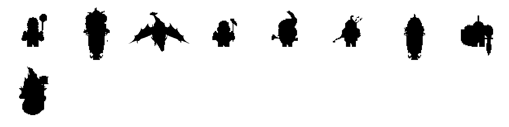

Order (8 per row; units / mounts to scale, titans / beasts fitted): ash_hurler, blaze_rider, cinder_dragon, cinder_hand, cinderlock, ember_archer, ember_boar, flame_guard, vessa

| pair | IoU | colour dE | verdict | tile |
|---|---|---|---|---|
| ember_archer / coin_cutter | 0.74 | 43.4 | close | [tile](pairs/ember_archer__coin_cutter.png) |
| ash_hurler / cinder_hand | 0.70 | 9.4 | close | [tile](pairs/ash_hurler__cinder_hand.png) |
| cinder_hand / ember_archer | 0.68 | 22.5 | close | [tile](pairs/cinder_hand__ember_archer.png) |
| ember_archer / tracker | 0.67 | 54.8 | close |  |
| cinderlock / tracker | 0.66 | 34.2 | close |  |
| cinderlock / ember_archer | 0.66 | 28.3 | close |  |
| cinderlock / coin_cutter | 0.66 | 16.6 | close |  |
| ember_archer / magpie | 0.65 | 61.6 | close |  |

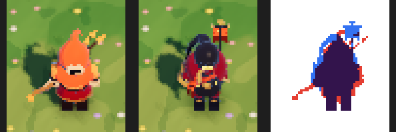
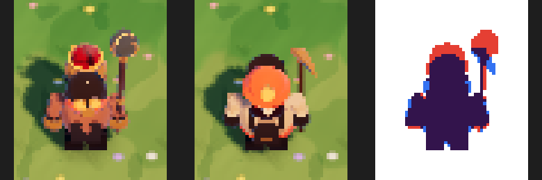
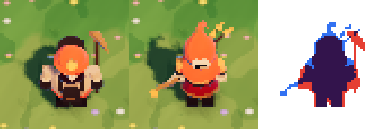

### Ice

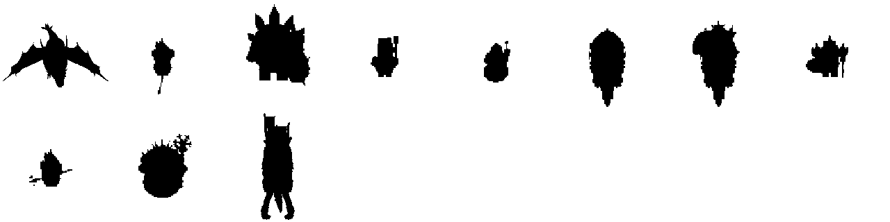

Order (8 per row; units / mounts to scale, titans / beasts fitted): frost_dragon, frostrune_rifleman, rime_colossus, rime_hauler, rime_seer, rimehorn, rimehorn_rider, rimeshield, shardcaster, torvald, war_mammoth

| pair | IoU | colour dE | verdict | tile |
|---|---|---|---|---|
| frostrune_rifleman / shardcaster | 0.76 | 3.5 | close | [tile](pairs/frostrune_rifleman__shardcaster.png) |
| frostrune_rifleman / coin_cutter | 0.67 | 52.1 | close | [tile](pairs/frostrune_rifleman__coin_cutter.png) |
| shardcaster / coin_cutter | 0.67 | 53.0 | close | [tile](pairs/shardcaster__coin_cutter.png) |
| rimehorn / tusker | 0.66 | 15.7 | close |  |
| rimehorn_rider / tusker | 0.65 | 14.1 | close |  |
| frostrune_rifleman / tracker | 0.64 | 31.6 | distinct |  |
| shardcaster / magpie | 0.64 | 30.5 | distinct |  |
| rimeshield / tracker | 0.64 | 27.5 | distinct |  |

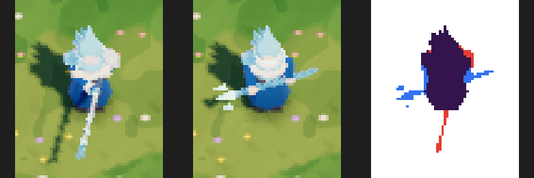
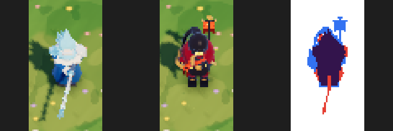
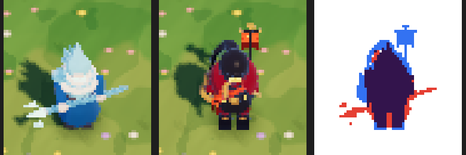

### Nature

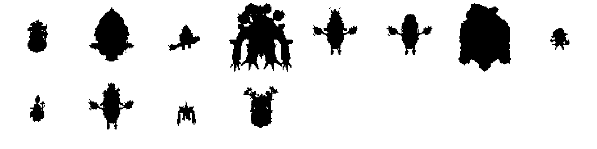

Order (8 per row; units / mounts to scale, titans / beasts fitted): bloomtender, bramblehorn, burr_slinger, elder_treant, glade_outrider, grove_stag, mossback, sapling, sprigling, stagrunner, thornling, ysolde

| pair | IoU | colour dE | verdict | tile |
|---|---|---|---|---|
| glade_outrider / stagrunner | 0.91 | 7.0 | READS ALIKE | [tile](pairs/glade_outrider__stagrunner.png) |
| bramblehorn / grizzlemaw | 0.70 | 33.4 | close | [tile](pairs/bramblehorn__grizzlemaw.png) |
| bramblehorn / tusker | 0.68 | 31.4 | close | [tile](pairs/bramblehorn__tusker.png) |
| sapling / magpie | 0.67 | 36.1 | close |  |
| thornling / magpie | 0.65 | 36.6 | distinct |  |
| bloomtender / wildcaller | 0.63 | 15.0 | distinct |  |
| bloomtender / wayfinder | 0.62 | 37.3 | distinct |  |
| bramblehorn / caravan | 0.62 | 39.3 | distinct |  |

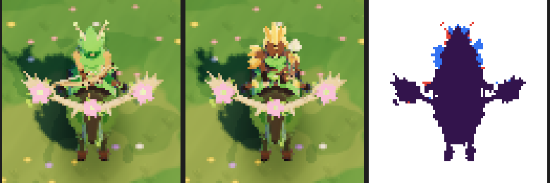
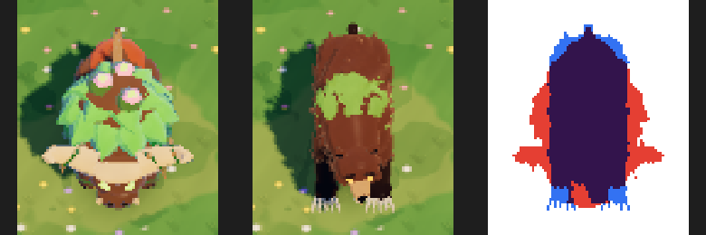
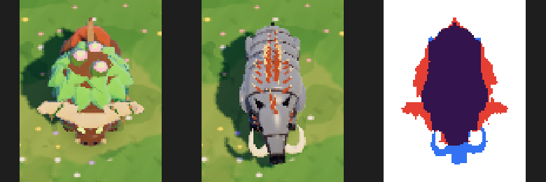

### Shadow

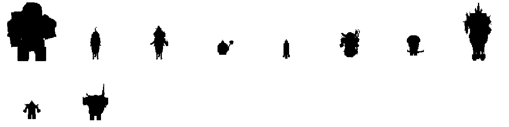

Order (8 per row; units / mounts to scale, titans / beasts fitted): barrow_giant, dusk_steed, gloam_rider, gloom_thrall, grave_hound, malrik, nightbolt, nightmare_knight, shade, shadow_knight

| pair | IoU | colour dE | verdict | tile |
|---|---|---|---|---|
| dusk_steed / roan_courser | 0.66 | 56.1 | close | [tile](pairs/dusk_steed__roan_courser.png) |
| shade / coin_cutter | 0.66 | 36.6 | close | [tile](pairs/shade__coin_cutter.png) |
| malrik / shadow_knight | 0.64 | 12.5 | distinct | [tile](pairs/malrik__shadow_knight.png) |
| nightbolt / tracker | 0.64 | 61.9 | distinct |  |
| shadow_knight / ruin_warden | 0.64 | 57.1 | distinct |  |
| malrik / wildcaller | 0.64 | 65.2 | distinct |  |
| shade / magpie | 0.63 | 34.5 | distinct |  |
| nightbolt / wayfinder | 0.63 | 62.0 | distinct |  |

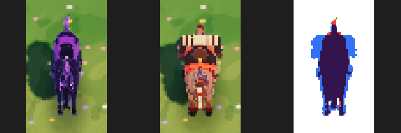
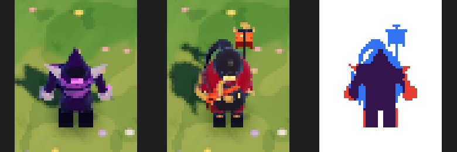
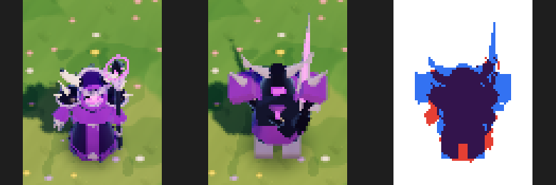

### Neutral

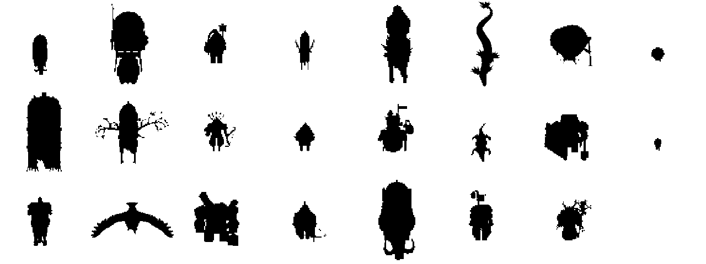

Order (8 per row; units / mounts to scale, titans / beasts fitted): bristleback, caravan, coin_cutter, deer, direwolf, frost_wyrm, gloomcap_elder, gloomcap_sprout, grizzlemaw, hollow_stag, mage_archer, magpie, mender, mirefang, oathwall, rabbit, roan_courser, roc, ruin_warden, tracker, tusker, wayfinder, wildcaller

| pair | IoU | colour dE | verdict | tile |
|---|---|---|---|---|
| grizzlemaw / tusker | 0.74 | 29.0 | close | [tile](pairs/grizzlemaw__tusker.png) |
| coin_cutter / tracker | 0.70 | 27.4 | close | [tile](pairs/coin_cutter__tracker.png) |
| caravan / tusker | 0.68 | 33.8 | close | [tile](pairs/caravan__tusker.png) |
| caravan / grizzlemaw | 0.66 | 15.7 | close |  |
| tracker / wayfinder | 0.66 | 21.5 | close |  |
| coin_cutter / mage_archer | 0.64 | 35.4 | distinct |  |
| coin_cutter / magpie | 0.64 | 28.3 | distinct |  |
| oathwall / ruin_warden | 0.63 | 18.9 | distinct |  |

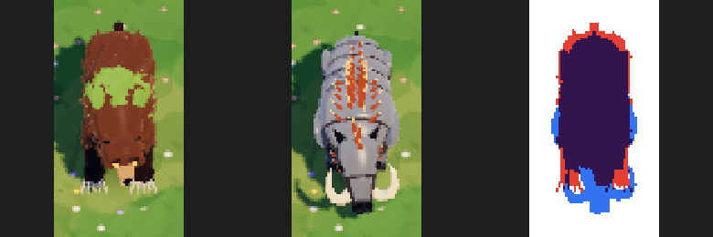
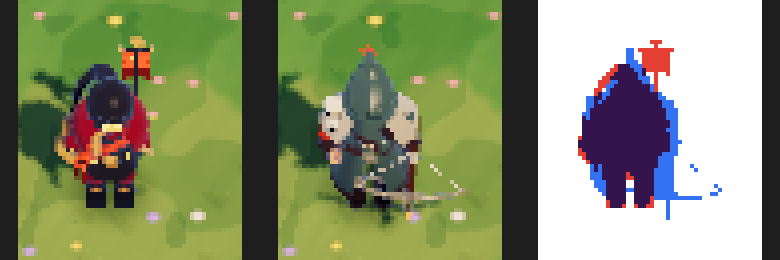
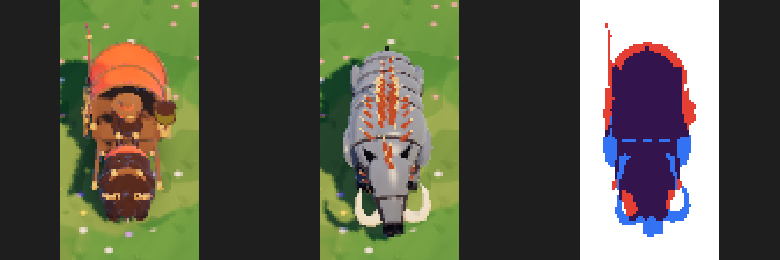

### Closest pairs across kingdoms (mirror-match risk: team colour is the only difference)

| pair | IoU | colour dE | verdict | tile |
|---|---|---|---|---|
| cinder_dragon / frost_dragon | 0.82 | 65.3 | same shape family, colour differs | [tile](pairs/cinder_dragon__frost_dragon.png) |
| cinder_hand / rime_hauler | 0.76 | 48.8 | close | [tile](pairs/cinder_hand__rime_hauler.png) |
| flame_guard / rimeshield | 0.75 | 77.8 | close | [tile](pairs/flame_guard__rimeshield.png) |
| vessa / malrik | 0.72 | 85.4 | close | [tile](pairs/vessa__malrik.png) |
| cinderlock / nightbolt | 0.70 | 66.6 | close |  |
| vessa / ysolde | 0.70 | 56.9 | close |  |
| vessa / torvald | 0.68 | 76.6 | close |  |
| ember_archer / shardcaster | 0.67 | 72.3 | close |  |

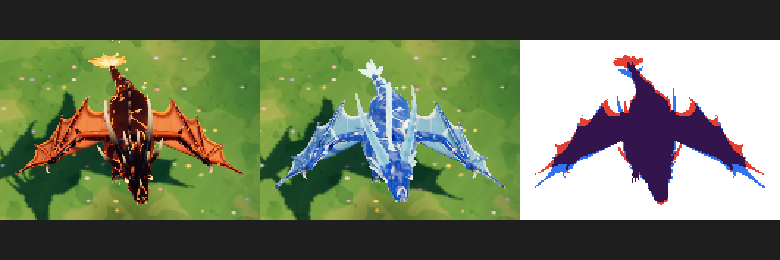
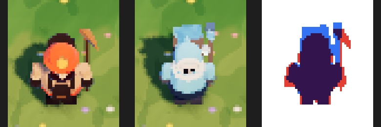
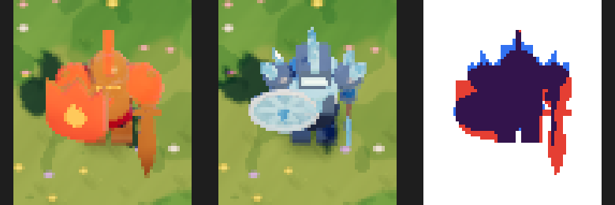
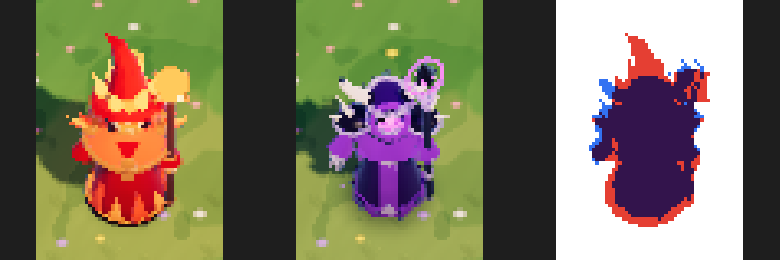

