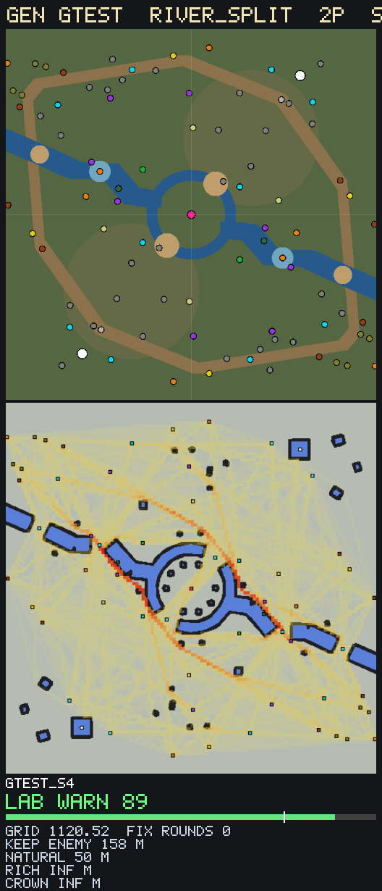

# World Forge gen: gtest

`run_world_forge.ps1 gen gtest archetype=river_split players=2 tempo=standard biome=grass count=4` (size 120 m). Grid pre-filter 39.8 s.

## Pick
**gtest_s4**: Map Lab WARN 89 after 0 fix round(s). Adopt: copy `data/maps/gen/gtest_s4.map` to `data/maps/<name>.map`, change the `map` id, run `map <name>`.

## Map Lab finals (top 1 of the sweep)
| Candidate | Grid | Map Lab | FAIL checks | Fix rounds | Log |
|---|---|---|---|---|---|
| gtest_s4 | 1120.52 | WARN 89 | 0 | 0 | round 0: Map Lab WARN 89 (0 FAIL checks), 3 fixable move(s) |

## Sweep (grid pre-filter, best first; targets { "keep_enemy": (116.0, 150.0), "natural": (38.0, 58.0), "rich": (65.0, 95.0), "crown": (50.0, 72.0) })
| # | Seed | Grid score | Unreachable | keep_enemy | natural | rich | crown | contest |
|---|---|---|---|---|---|---|---|---|
| 1 | 4 | 1120.52 | 18 | 158 | 50 | inf | inf | 0 |
| 2 | 1 | 2420.00 | 42 | inf | inf | 82 | inf | 0 |
| 3 | 3 | 2420.00 | 42 | inf | 54 | inf | inf | 0 |
| 4 | 2 | 2570.00 | 43 | inf | inf | inf | inf | 0 |

