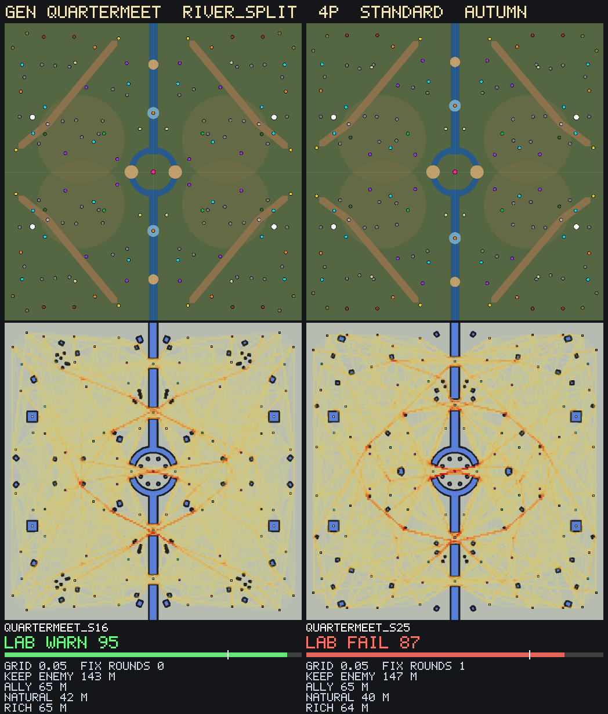

# World Forge gen: quartermeet

`run_world_forge.ps1 gen quartermeet archetype=river_split players=4 tempo=standard biome=autumn count=40` (size 176 m). Grid pre-filter 195.9 s.

## Pick
**quartermeet_s16**: Map Lab WARN 95 after 0 fix round(s). Adopt: copy `data/maps/gen/quartermeet_s16.map` to `data/maps/<name>.map`, change the `map` id, run `map <name>`.

## Map Lab finals (top 2 of the sweep)
| Candidate | Grid | Map Lab | FAIL checks | Fix rounds | Log |
|---|---|---|---|---|---|
| quartermeet_s16 | 0.05 | WARN 95 | 0 | 0 | round 0: Map Lab WARN 95 (0 FAIL checks), 2 fixable move(s) |
| quartermeet_s25 | 0.05 | FAIL 87 | 2 | 1 | round 0: Map Lab FAIL 86 (1 FAIL checks), 2 fixable move(s); round 1: Map Lab FAIL 87 (1 FAIL checks), 0 fixable move(s) |

## Sweep (grid pre-filter, best first; targets { "ally": (60.0, 72.0), "enemy_ally": (2.0, 3.0), "keep_enemy": (130.0, 185.0), "natural": (32.0, 56.0), "rich": (50.0, 95.0), "crown": (60.0, 95.0) })
| # | Seed | Grid score | Unreachable | ally | enemy_ally | keep_enemy | natural | rich | crown | contest |
|---|---|---|---|---|---|---|---|---|---|---|
| 1 | 16 | 0.05 | 0 | 65 | 2.20 | 143 | 42 | 65 | 85 | 7 |
| 2 | 25 | 0.05 | 0 | 65 | 2.26 | 147 | 40 | 64 | 85 | 6 |
| 3 | 39 | 0.07 | 0 | 65 | 2.23 | 145 | 40 | 66 | 84 | 6 |
| 4 | 18 | 0.07 | 0 | 66 | 2.19 | 145 | 43 | 66 | 85 | 6 |
| 5 | 31 | 0.07 | 0 | 64 | 2.26 | 144 | 43 | 65 | 85 | 6 |
| 6 | 40 | 0.08 | 0 | 65 | 2.20 | 143 | 43 | 67 | 85 | 6 |
| 7 | 34 | 0.08 | 0 | 65 | 2.20 | 143 | 41 | 66 | 83 | 6 |
| 8 | 28 | 0.08 | 0 | 65 | 2.23 | 145 | 39 | 69 | 85 | 6 |
| 9 | 17 | 0.09 | 0 | 65 | 2.23 | 145 | 38 | 67 | 84 | 6 |
| 10 | 6 | 0.09 | 0 | 65 | 2.19 | 142 | 42 | 66 | 84 | 6 |
| 11 | 30 | 0.09 | 0 | 67 | 2.17 | 145 | 42 | 67 | 85 | 6 |
| 12 | 1 | 0.10 | 0 | 66 | 2.18 | 143 | 42 | 64 | 84 | 6 |
| 13 | 32 | 0.11 | 0 | 66 | 2.17 | 143 | 40 | 67 | 84 | 6 |
| 14 | 20 | 0.11 | 0 | 68 | 2.16 | 146 | 44 | 64 | 85 | 6 |
| 15 | 8 | 0.12 | 0 | 65 | 2.21 | 144 | 38 | 67 | 85 | 6 |
| 16 | 27 | 0.13 | 0 | 67 | 2.13 | 143 | 43 | 67 | 85 | 6 |
| 17 | 23 | 0.13 | 0 | 66 | 2.14 | 141 | 41 | 67 | 83 | 6 |
| 18 | 11 | 0.14 | 0 | 67 | 2.14 | 144 | 42 | 64 | 85 | 6 |
| 19 | 7 | 0.14 | 0 | 67 | 2.16 | 144 | 39 | 66 | 85 | 6 |
| 20 | 38 | 0.14 | 0 | 65 | 2.17 | 141 | 40 | 64 | 83 | 6 |
| 21 | 33 | 0.14 | 0 | 66 | 2.15 | 143 | 40 | 66 | 85 | 6 |
| 22 | 3 | 0.15 | 0 | 67 | 2.13 | 143 | 41 | 66 | 85 | 6 |
| 23 | 22 | 0.15 | 0 | 65 | 2.20 | 143 | 38 | 64 | 83 | 6 |
| 24 | 10 | 0.16 | 0 | 67 | 2.14 | 143 | 40 | 65 | 84 | 6 |
| 25 | 29 | 0.16 | 0 | 67 | 2.13 | 142 | 41 | 65 | 84 | 6 |
| 26 | 24 | 0.16 | 0 | 67 | 2.16 | 145 | 39 | 64 | 85 | 6 |
| 27 | 36 | 0.16 | 0 | 67 | 2.14 | 143 | 42 | 61 | 83 | 6 |
| 28 | 12 | 0.17 | 0 | 65 | 2.15 | 140 | 40 | 64 | 83 | 6 |
| 29 | 5 | 0.17 | 0 | 67 | 2.10 | 141 | 41 | 67 | 84 | 6 |
| 30 | 13 | 0.18 | 0 | 65 | 2.19 | 142 | 36 | 65 | 83 | 6 |
| 31 | 14 | 0.19 | 0 | 67 | 2.13 | 142 | 39 | 64 | 84 | 6 |
| 32 | 9 | 0.20 | 0 | 67 | 2.10 | 141 | 41 | 63 | 84 | 6 |
| 33 | 26 | 0.20 | 0 | 65 | 2.15 | 140 | 39 | 61 | 82 | 6 |
| 34 | 37 | 0.21 | 0 | 67 | 2.07 | 139 | 41 | 67 | 83 | 6 |
| 35 | 35 | 0.22 | 0 | 68 | 2.09 | 143 | 41 | 65 | 85 | 6 |
| 36 | 4 | 0.22 | 0 | 67 | 2.08 | 140 | 40 | 64 | 83 | 6 |
| 37 | 2 | 0.25 | 0 | 67 | 2.11 | 141 | 37 | 65 | 83 | 6 |
| 38 | 15 | 0.25 | 0 | 67 | 2.07 | 139 | 40 | 64 | 83 | 6 |
| 39 | 21 | 0.25 | 0 | 67 | 2.07 | 139 | 39 | 64 | 83 | 6 |
| 40 | 19 | 0.29 | 0 | 69 | 2.04 | 141 | 41 | 67 | 84 | 6 |

