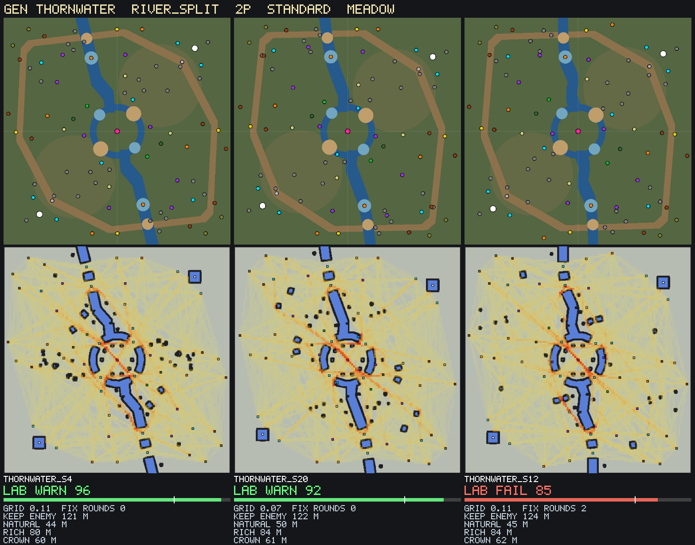

# World Forge gen: thornwater

`run_world_forge.ps1 gen thornwater archetype=river_split players=2 tempo=standard biome=meadow count=40` (size 120 m). Grid pre-filter 287.7 s.

## Pick
**thornwater_s4**: Map Lab WARN 96 after 0 fix round(s). Adopt: copy `data/maps/gen/thornwater_s4.map` to `data/maps/<name>.map`, change the `map` id, run `map <name>`.

## Map Lab finals (top 3 of the sweep)
| Candidate | Grid | Map Lab | FAIL checks | Fix rounds | Log |
|---|---|---|---|---|---|
| thornwater_s4 | 0.11 | WARN 96 | 0 | 0 | round 0: Map Lab WARN 96 (0 FAIL checks), 2 fixable move(s) |
| thornwater_s20 | 0.07 | WARN 92 | 0 | 0 | round 0: Map Lab WARN 92 (0 FAIL checks), 4 fixable move(s) |
| thornwater_s12 | 0.11 | FAIL 85 | 2 | 2 | round 0: Map Lab FAIL 84 (1 FAIL checks), 2 fixable move(s); round 1: Map Lab FAIL 84 (1 FAIL checks), 1 fixable move(s); round 2: Map Lab FAIL 85 (1 FAIL checks), 0 fixable move(s) |

## Sweep (grid pre-filter, best first; targets { "keep_enemy": (116.0, 150.0), "natural": (38.0, 58.0), "rich": (65.0, 95.0), "crown": (50.0, 72.0) })
| # | Seed | Grid score | Unreachable | Spacing FAIL | keep_enemy | natural | rich | crown | contest |
|---|---|---|---|---|---|---|---|---|---|
| 1 | 20 | 0.07 | 0 | 0 | 122 | 50 | 84 | 61 | 6 |
| 2 | 12 | 0.11 | 0 | 0 | 124 | 45 | 84 | 62 | 5 |
| 3 | 4 | 0.11 | 0 | 0 | 121 | 44 | 80 | 60 | 6 |
| 4 | 10 | 0.15 | 0 | 0 | 122 | 49 | 86 | 61 | 5 |
| 5 | 13 | 0.18 | 0 | 0 | 117 | 43 | 81 | 59 | 7 |
| 6 | 39 | 0.20 | 0 | 0 | 119 | 45 | 86 | 59 | 6 |
| 7 | 32 | 100.06 | 0 | 0 | 122 | 49 | 80 | 61 | 6 |
| 8 | 22 | 100.06 | 0 | 0 | 122 | 50 | 81 | 61 | 6 |
| 9 | 40 | 100.07 | 0 | 0 | 122 | 48 | 83 | 61 | 6 |
| 10 | 24 | 100.09 | 0 | 0 | 121 | 46 | 81 | 60 | 6 |
| 11 | 29 | 100.12 | 0 | 0 | 122 | 50 | 82 | 61 | 5 |
| 12 | 26 | 100.12 | 0 | 0 | 122 | 45 | 82 | 61 | 5 |
| 13 | 35 | 100.13 | 0 | 0 | 119 | 49 | 81 | 59 | 6 |
| 14 | 28 | 100.13 | 0 | 0 | 122 | 49 | 83 | 60 | 5 |
| 15 | 9 | 100.13 | 0 | 0 | 122 | 47 | 83 | 61 | 5 |
| 16 | 7 | 100.14 | 0 | 0 | 117 | 50 | 83 | 59 | 7 |
| 17 | 18 | 100.15 | 0 | 0 | 122 | 44 | 80 | 61 | 5 |
| 18 | 14 | 100.15 | 0 | 0 | 119 | 45 | 78 | 59 | 6 |
| 19 | 2 | 100.16 | 0 | 0 | 120 | 43 | 80 | 60 | 6 |
| 20 | 34 | 100.16 | 0 | 0 | 120 | 48 | 82 | 60 | 5 |
| 21 | 5 | 100.17 | 0 | 0 | 122 | 45 | 89 | 61 | 6 |
| 22 | 33 | 100.18 | 0 | 0 | 121 | 41 | 85 | 60 | 7 |
| 23 | 17 | 100.18 | 0 | 0 | 119 | 48 | 83 | 60 | 5 |
| 24 | 3 | 100.18 | 0 | 0 | 123 | 44 | 87 | 61 | 5 |
| 25 | 25 | 100.19 | 0 | 0 | 120 | 43 | 84 | 60 | 6 |
| 26 | 31 | 100.20 | 0 | 0 | 119 | 47 | 84 | 59 | 5 |
| 27 | 21 | 100.20 | 0 | 0 | 119 | 43 | 84 | 60 | 6 |
| 28 | 15 | 100.21 | 0 | 0 | 120 | 47 | 86 | 60 | 5 |
| 29 | 6 | 100.22 | 0 | 0 | 119 | 44 | 84 | 60 | 5 |
| 30 | 8 | 100.23 | 0 | 0 | 121 | 42 | 83 | 60 | 5 |
| 31 | 38 | 100.24 | 0 | 0 | 119 | 43 | 80 | 60 | 5 |
| 32 | 16 | 100.24 | 0 | 0 | 120 | 42 | 88 | 60 | 6 |
| 33 | 30 | 100.26 | 0 | 0 | 119 | 41 | 84 | 59 | 6 |
| 34 | 37 | 104.17 | 0 | 0 | 120 | 48 | 83 | 59 | 4 |
| 35 | 11 | 104.21 | 0 | 0 | 121 | 43 | 82 | 60 | 4 |
| 36 | 36 | 104.23 | 0 | 0 | 119 | 45 | 86 | 60 | 4 |
| 37 | 19 | 204.44 | 0 | 0 | 119 | 39 | 88 | 59 | 4 |
| 38 | 23 | 500.10 | 0 | 2 | 122 | 48 | 79 | 61 | 5 |
| 39 | 27 | 500.14 | 0 | 2 | 119 | 47 | 79 | 59 | 6 |
| 40 | 1 | 504.20 | 0 | 2 | 119 | 46 | 84 | 59 | 4 |

